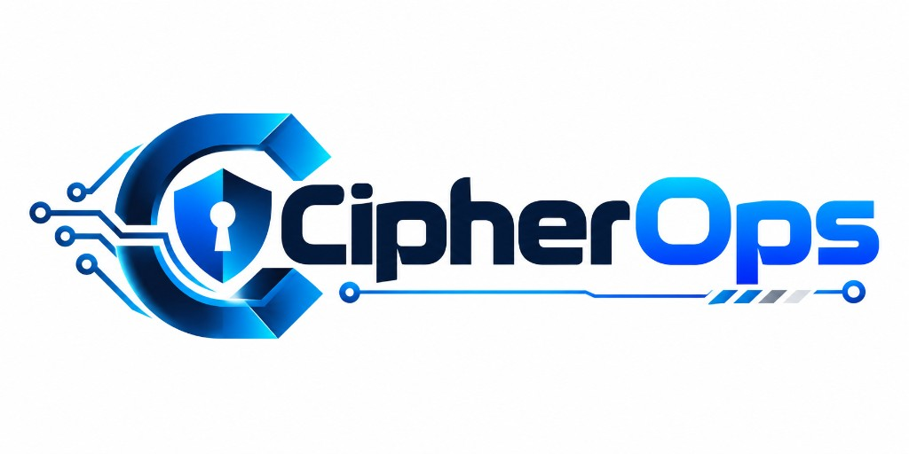

<div align="center">
  <picture>
    <source media="(prefers-color-scheme: dark)" srcset="docs/media/cipherops-logo-dark.png">
    
  </picture>

  # CipherOps

  **A reproducible benchmark of Merkle Tree Ladder (MTL) mode for post-quantum DNSSEC signatures**

  AIORI Hackathon 3 · PS-036 · Team A3-PS036-TC161
</div>

## What this is

Post-quantum signatures are large. A single SLH-DSA-SHA2-128s signature is 7,856 bytes, so a signed DNS answer
no longer fits in one UDP packet: it is truncated, retried over TCP, or fragmented. **MTL mode**
([draft-harvey-cfrg-mtl-mode](https://datatracker.ietf.org/doc/draft-harvey-cfrg-mtl-mode/)) signs a whole zone once and
gives each record a short authentication path instead.

CipherOps measures what that changes, for **one PQC algorithm (SLH-DSA-SHA2-128s) with and without MTL**, against a
classical reference, across **three dataset sizes**: signing time, verification time, transmitted bytes and cache
use. It drives the unmodified [Verisign MTL](https://github.com/verisign/MTL) reference library, liboqs and OpenSSL.
**No cryptography is implemented here.**

| Mode | Algorithm | Library |
| --- | --- | --- |
| `slh-dsa-mtl` | SLH-DSA-SHA2-128s with MTL | Verisign MTL reference library |
| `slh-dsa` | SLH-DSA-SHA2-128s without MTL | liboqs |
| `ed25519`, `ecdsa-p256`, `rsa-2048` | classical DNSSEC references | OpenSSL |

There are two measurement paths that answer different questions:

| | Offline harness | Live lab |
| --- | --- | --- |
| What it is | a C harness (`harness/mtlbench.c`) times each library call; DNS messages are built and counted in Python | a root → TLD → leaf hierarchy of unmodified NSD servers behind a validating Unbound, in Docker |
| Best for | signing and verification time, signature and response sizes, cache arithmetic | what a resolver actually does: bytes per hop from packet captures, truncation, TCP retry, Unbound's cache counters |
| Environment | one pinned image, one dedicated CPU core, no network | three images per stack; containers share all host CPUs |
| Start it with | `scripts/run_benchmark.sh` | `streamlit run dashboard/live_lab/app.py` |

## Status and limits

Read this before relying on any number.

- **Reference implementation.** The mentor approved choosing Verisign's MTL implementation but has **not tested a
  specific version**. PS-036 asks for a mentor-tested implementation; that is unconfirmed, and nothing in this
  repository claims full PS-036 compliance.
- **Fixtures.** The reference library's bundled known-answer vectors cover ML-DSA, not SLH-DSA. SLH-DSA-specific fixtures
  are unconfirmed. SLH-DSA is checked by round trips, negative cases and agreement between two independent
  implementations (liboqs and OpenSSL, plus Verisign's `mtlverify`). That is an interoperability check, **not** a
  NIST known-answer test. See [methodology §3](docs/methodology.md#3-gono-go-gate).
- **Versions differ between the two paths** (table below). Offline and live-lab numbers are not interchangeable.
- **`latest` stack:** its Unbound answers SERVFAIL for plain SLH-DSA although the signed zone is valid and `draft06`
  validates it. The live MTL-versus-non-MTL comparison is valid on `draft06` only.
- **Live-lab timings are indicative.** Containers are not pinned to cores, and the host CPU governor is recorded, not
  changed. Byte counts and relative comparisons are more reliable than absolute milliseconds.
- **Few trials give wide intervals.** With 5 trials the interval of the median covers 94%, not 95%
  ([methodology §6.2](docs/methodology.md#62-statistics)).
- Code points (DNSSEC algorithm numbers, the `mtl-mode-full` EDNS option) are lab placeholders, not IANA assignments.
  Nothing here is for the Internet, and no security claim is made.

### Pinned software

| Path | Base | OpenSSL | liboqs | Verisign MTL | Behaviour |
| --- | --- | --- | --- | --- | --- |
| Offline harness (`docker/`) | Fedora 42 | 3.6.0 | 0.16.0 | `7cef019` | library calls timed directly |
| Live lab `draft06` (default) | see [`ecosystem/docker/Dockerfile`](ecosystem/docker/Dockerfile) | 3.6.0 | 0.14.0 | 1.2.0 (`93b05ef`) | condensed signatures by default; full signature on EDNS option 65050 |
| Live lab `latest` | same | 3.6.0 | 0.16.0 | `7cef019` | every MTL RRSIG is served as a full signature; plain SLH-DSA not validated |

All component commits (NSD, Unbound, ldns) are in [`ecosystem/stacks/`](ecosystem/stacks). Verisign MTL 1.2.1 is a
candidate for aligning the paths; it is **not** adopted and has not been tested.

## PS-036 requirements

| Requirement | Where it is met | State |
| --- | --- | --- |
| One supported PQC algorithm | SLH-DSA-SHA2-128s | done |
| One mentor-tested MTL reference implementation | Verisign MTL | **unconfirmed** (see above) |
| Three dataset sizes | 50 / 500 / 5,000 names by default; quick run 20 / 60 / 200 | done |
| With and without MTL | `slh-dsa-mtl` vs `slh-dsa`, plus classical references | done |
| Repeated trials, pinned environment | pinned image, dedicated core, seeded order, discarded warm-up | done offline; live lab not core-pinned |
| Signing time, verification time, transmitted bytes | `trials.csv`, `responses.csv`, `workload.csv`; live-lab captures | done |
| Record configuration and workload parameters | `config.yaml`, `environment.json`, `suite.json` in each run | done |
| Cache: measured vs analytical, kept apart | `cache.csv` has a `kind` column; the report never mixes them | done |
| Defer if implementation or fixtures are missing | go/no-go gate (`preflight`) blocks the run | done for the implementation; SLH-DSA fixtures unconfirmed |
| No new cryptography, resolver or deployment | the harness only calls libraries; the lab uses stock servers | done |

## Quick start

**Requirements:** Docker with Compose v2, about 3 CPU cores and 6 GB of RAM (the harness is pinned to core 2 by
default; pass a different core as the second argument of the script), git. Python 3.11+ is needed only for the
dashboard and the host tests. Commands below are for Linux and macOS; PowerShell equivalents (`scripts/*.ps1`) exist
for Windows but were not re-run in the latest review.

```bash
git clone https://github.com/aiori-hackathon/A3-PS036-TC161.git
cd A3-PS036-TC161
```

### 1. Offline benchmark

```bash
bash scripts/run_benchmark.sh preflight               # build the image and run the go/no-go gate
bash scripts/run_benchmark.sh configs/quick.yaml      # short demonstration run
bash scripts/run_benchmark.sh                         # full run (configs/scenarios.yaml); can take over an hour
```

The first build compiles OpenSSL, liboqs and MTL from source (several minutes); later runs reuse the cache. A run
prints its folder, `results/runs/<timestamp>-<name>/`; open `report.html` there. If the gate fails, no numbers are
produced and the run exits with `NO-GO`.

Optional, on a finished run: serve its signed zone from a real NSD over LAN, WAN and lossy network profiles and
capture the packets.

```bash
bash scripts/run_live.sh <run-folder> lan 1232 1      # one profile, one UDP size, one repeat
```

### 2. Live lab (browser)

```bash
pip install -r requirements-dashboard.txt
streamlit run dashboard/live_lab/app.py
```

| Tile | Use |
| --- | --- |
| **Setup** | step 1 build or pull the images; step 2 choose zone size and scenarios, then **Prepare** (signs the hierarchy); step 3 **Start** the lab |
| **Live** | send queries or `dig`, switch scenario, capture packets, view the packet sequence |
| **Benchmark** | one press runs the PS-036 benchmark: three dataset sizes, repeated signing and measurement trials; needs only the built images |
| **Compare** | MTL against SLH-DSA and the classical reference from a finished benchmark |
| **Reset** | remove sessions, captures, runs or signed zones |

Use the **`draft06`** image version for the MTL-versus-non-MTL comparison. A first image build takes tens of minutes;
it runs in the background with a live log. Details: [`dashboard/live_lab/README.md`](dashboard/live_lab/README.md).

## What a run produces

Each offline run writes `results/runs/<id>/`:

| File | Content |
| --- | --- |
| `report.html`, `report.md`, `figures/` | the report: method, results, limitations, traceability to PS-036, demonstration pseudocode |
| `config.yaml`, `environment.json`, `preflight.json` | the exact settings, software and hardware, and go/no-go checks |
| `trials.csv`, `ops.parquet` | one row per trial; one row per timed library call |
| `responses.csv`, `workload.csv`, `sizes.csv` | DNS message sizes and workload byte accounting; measured MTL sizes against the draft's formulas |
| `cache.csv` | cache rows, each marked `measured` or `analytical` |
| `summary.json`, `raw/`, `artifacts/` | statistics with confidence intervals; raw harness output; the signatures used for the byte analysis |

A live-lab benchmark writes `ecosystem/results/suites/<id>/` with `suite.json` (parameters, host and image
provenance), per-size signing and measurement CSVs, and its own `report.html`. Column definitions:
[docs/outputs-reference.md](docs/outputs-reference.md). Numbers are not copied into the documentation; they live in each
run's report so they cannot drift.

## Tests

```bash
pip install -r requirements-dashboard.txt
PYTHONPATH=src python3 -m pytest tests -m "not harness"          # host tests, no Docker needed
```

Harness correctness gates need the compiled harness and reference library, so they run inside the image:

```bash
docker run --rm --network none cipherops-bench:pinned \
  "python3 -m pytest tests/test_harness.py tests/test_crosscheck.py -q"
```

`python3 scripts/show_fixes.py` runs an earlier commit and the working tree side by side and prints what changed in
demo safety, `dig` input checks and harness negative cases.

## Troubleshooting

| Symptom | Cause and fix |
| --- | --- |
| `Permission denied` under `ecosystem/work` or `results` | Docker creates files as root on Linux. The dashboard's Reset removes them; by hand use `sudo rm -rf`. |
| Prepare or Start disabled in Setup | the images for the chosen version are not built yet (step 1) |
| Every query to `slh-dsa` returns SERVFAIL on `latest` | known limitation of that stack; use `draft06` |
| Docker refuses to start the benchmark container with a `cpuset` error | the host has fewer than 3 cores; pass another core number as the second script argument |
| Lab buttons greyed out | a benchmark is running and owns the lab; wait or cancel it |
| Image build seems idle | it runs in the background; open Setup to see the log, or Cancel build |

## Repository layout

```
configs/        offline run settings (full and quick)
docker/         pinned offline image and Compose services
harness/        mtlbench.c, linked to the reference libraries
src/cipherops/  runner, preflight gate, workload, DNS wire model, statistics, report
ecosystem/      live lab: images, stack pins, lab orchestration (ecolab), IETF draft notes
dashboard/      Streamlit live lab (dashboard/app.py launches live_lab/app.py)
scripts/        run_benchmark, run_live, show_fixes, learning trace (own.py)
tests/          unit tests (host) and harness gates (Docker)
docs/           methodology, architecture, flow, output reference
```

## Documentation

- [Methodology](docs/methodology.md): what is measured and how, statistics, limits
- [Architecture](docs/architecture.md): components and data flow
- [End-to-end flow](docs/end-to-end-flow.md): the seven stages of a run
- [Outputs reference](docs/outputs-reference.md): every file and column
- [Live lab guide](dashboard/live_lab/README.md)
- [IETF draft notes](ecosystem/drafts/README.md)

Presentation: [`A3-PS036-TC161.pptx.pdf`](A3-PS036-TC161.pptx.pdf).

## Team and licence

**A3-PS036-TC161**: Akash Joshi, Anitha, Induradhakrishnan. MIT licence, see [LICENSE](LICENSE). Verisign MTL, liboqs,
OpenSSL and NSD keep their own licences.
