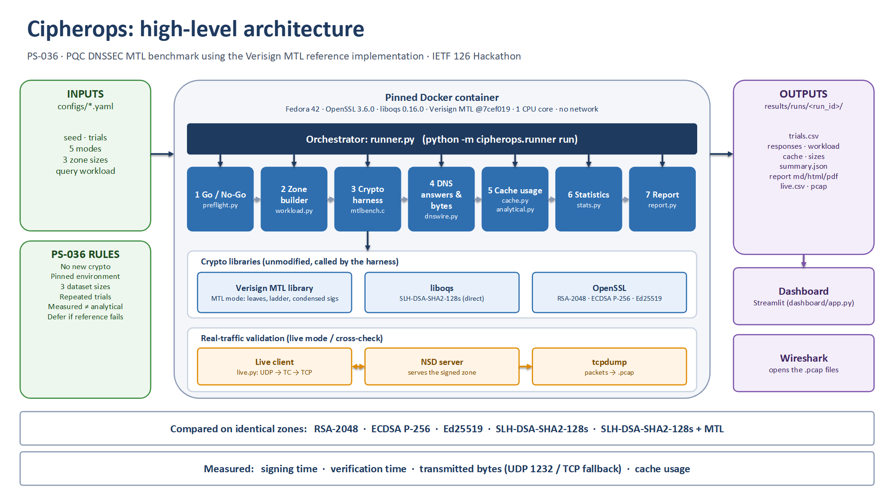

<div align="center">
  <picture>
    <source media="(prefers-color-scheme: dark)" srcset="docs/media/cipherops-logo-dark.png">
    
  </picture>

  # CipherOps

  **PQC DNSSEC MTL benchmark using a reference implementation**

  AIORI Hackathon 3 · PS-036 · Team **A3-PS036-TC161**

  <p>
    <a href="https://portal.aiori.in/aiori-3/hackathon-guideline/"></a>
    <a href="https://portal.aiori.in/aiori-3/hackathon-guideline/"></a>
    <a href="https://youtu.be/FaVfeO5WTV8"></a>
  </p>
</div>

Post-quantum DNSSEC signatures are large; answers stop fitting in one UDP packet.
**Merkle Tree Ladder (MTL) mode** signs a zone once and attaches a short proof per record.
Cipherops measures what that changes — against classical DNSSEC and against plain SLH-DSA —
using the [Verisign MTL](https://github.com/verisign/MTL) reference stack, unmodified.

## For the panel

| | |
| :--- | :--- |
| **Presentation** | [`A3-PS036-TC161.pptx.pdf`](A3-PS036-TC161.pptx.pdf) |
| **Project video** | [YouTube](https://youtu.be/FaVfeO5WTV8) |
| **Live lab (browser)** | [Quick start below](#live-lab-browser) — root → TLD → leaf, validating Unbound, packet sequence from real captures |
| **How we measure** | [Methodology](docs/methodology.md) · [Architecture](docs/architecture.md) |

Numbers live in each run’s `report.html` under `results/runs/` — not duplicated here, so this page stays current when you re-run.

---

## What you get

| Mode | Algorithm | Library |
| ----------------------------------- | ----------------------------- | ------------------------------------------------------------------------ |
| `slh-dsa-mtl` | SLH-DSA-SHA2-128s in MTL mode | [Verisign MTL](https://github.com/verisign/MTL) |
| `slh-dsa` | SLH-DSA-SHA2-128s directly | liboqs |
| `ed25519`, `ecdsa-p256`, `rsa-2048` | Classical DNSSEC | OpenSSL |

The offline Docker image uses Fedora 42, OpenSSL 3.6.0, liboqs 0.16.0, and Verisign MTL `7cef019`. The live lab's default [`draft06` stack](ecosystem/stacks/draft06.env) uses liboqs 0.14.0 and Verisign MTL 1.2.0 (`93b05ef`); it is a separate pinned stack.

### Reference implementation status

The mentor approved choosing Verisign's MTL reference implementation but has not tested a specific version. PS-036's mentor-tested implementation requirement, and the availability of SLH-DSA-specific test fixtures, need clarification with the organizers.

Verisign MTL 1.2.1 is a candidate for aligning the offline and live lab paths, subject to compatibility and correctness testing. It is not yet the pinned version for either path. The current offline preflight's bundled known-answer vectors cover ML-DSA; SLH-DSA is checked through reference-tool round trips and harness smoke tests.



### Scope (honest)

- Empirical timings and wire sizes on pinned environments — not a security proof or a production DNSSEC product.
- Offline harness (zone sign / verify / model) plus an optional live hierarchy (NSD + Unbound) with packet capture.
- Absolute milliseconds depend on the host; fair comparisons share the same image and configs.

---

## Requirements

- **Docker** (Desktop or Engine) — about 3 CPUs / 6 GB RAM
- **git**
- **Python 3.11+** — dashboard / live lab only

```bash
git clone https://github.com/aiori-hackathon/A3-PS036-TC161.git
cd A3-PS036-TC161
```

First image build compiles OpenSSL, liboqs, and MTL (a few minutes). Later runs reuse it.

---

## Live lab (browser)

Interactive control room for the multi-zone eco stack: prepare zones, start services, pick a scenario, query, then inspect metrics and **packet sequences from the capture you just took**.

```bash
pip install -r requirements-dashboard.txt
streamlit run dashboard/live_lab/app.py
```

Needs Docker. Start with **Small** zone size for Live. The **Benchmark** tile runs the PS-036 benchmark (three dataset sizes, repeated trials) by itself once the images are built, and **Compare** shows MTL against SLH-DSA from it. Walkthrough: [`dashboard/live_lab/README.md`](dashboard/live_lab/README.md).

---

## Offline benchmark

### 1. Preflight (go / no-go)

```powershell
# Windows
powershell -ExecutionPolicy Bypass -File .\scripts\run_benchmark.ps1 -Command preflight
```

```bash
# macOS / Linux
bash scripts/run_benchmark.sh preflight
```

### 2. Run

```powershell
powershell -ExecutionPolicy Bypass -File .\scripts\run_benchmark.ps1 -Config configs/quick.yaml   # short demo
powershell -ExecutionPolicy Bypass -File .\scripts\run_benchmark.ps1                              # full ~1.5 h
```

```bash
bash scripts/run_benchmark.sh configs/quick.yaml
bash scripts/run_benchmark.sh
```

### 3. Live validation (optional)

Replay lookups against NSD over LAN / WAN / lossy profiles; captures land in the run folder.

```powershell
powershell -ExecutionPolicy Bypass -File .\scripts\run_live.ps1 -Run <run-folder>
```

---

## Output

Each run writes under `results/runs/<id>/` — `report.html`, CSVs, figures, `environment.json`, and (live mode) `pcap/`. Column-level detail: [Outputs reference](docs/outputs-reference.md).

---

## Configuration

`configs/scenarios.yaml` is the full matrix; `configs/quick.yaml` is the short demo. Knobs: trials, modes, zone sizes, wire workload, seed. See comments in those files.

---

## Repository layout

```
configs/        run settings
docker/         pinned image and compose
harness/        mtlbench.c linked to reference libs
src/cipherops/  offline runner, report, live validation
ecosystem/      multi-zone lab (NSD / Unbound / MTL signing)
dashboard/      Streamlit live lab: setup, live queries, benchmark suite, compare
scripts/        Windows / Unix entry points
docs/           methodology, architecture, brand (docs/media)
tests/          gates and unit tests
```

## Documentation

- [Methodology](docs/methodology.md)
- [Architecture](docs/architecture.md)
- [Outputs reference](docs/outputs-reference.md)
- [Live lab](dashboard/live_lab/README.md)

## Team

**A3-PS036-TC161** — Akash Joshi · Anitha · Induradhakrishnan

## License

MIT — see [LICENSE](LICENSE). Verisign MTL, liboqs, OpenSSL, and NSD keep their own licences at build time.
