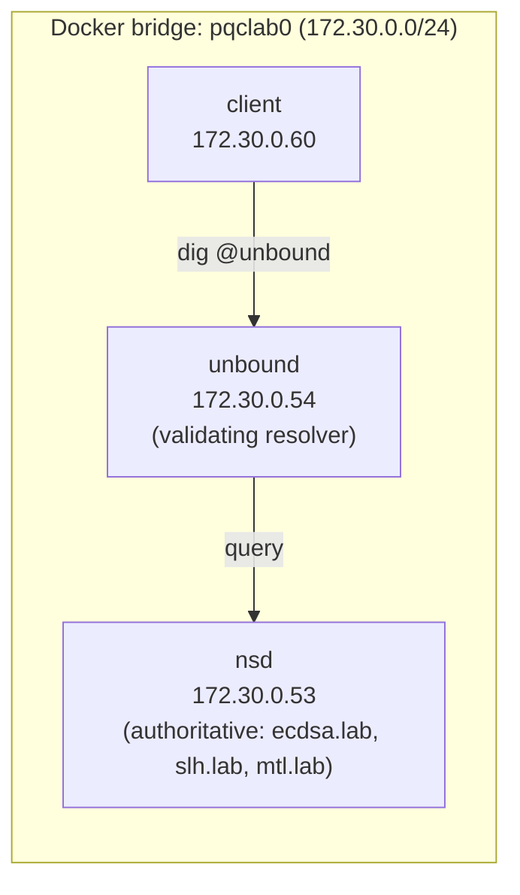
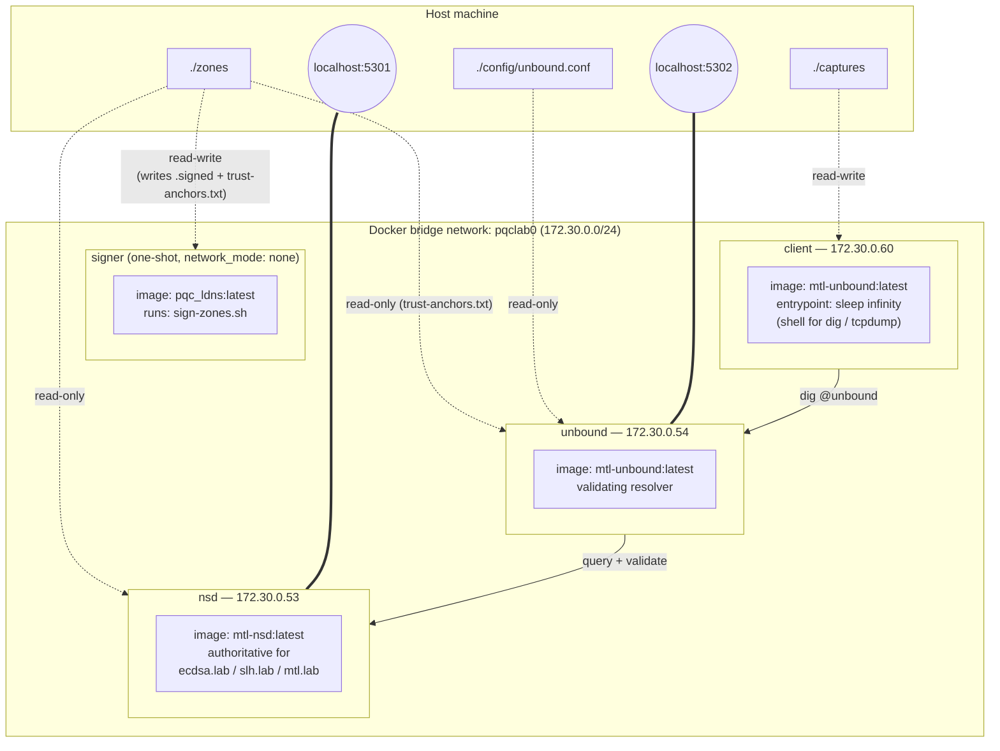
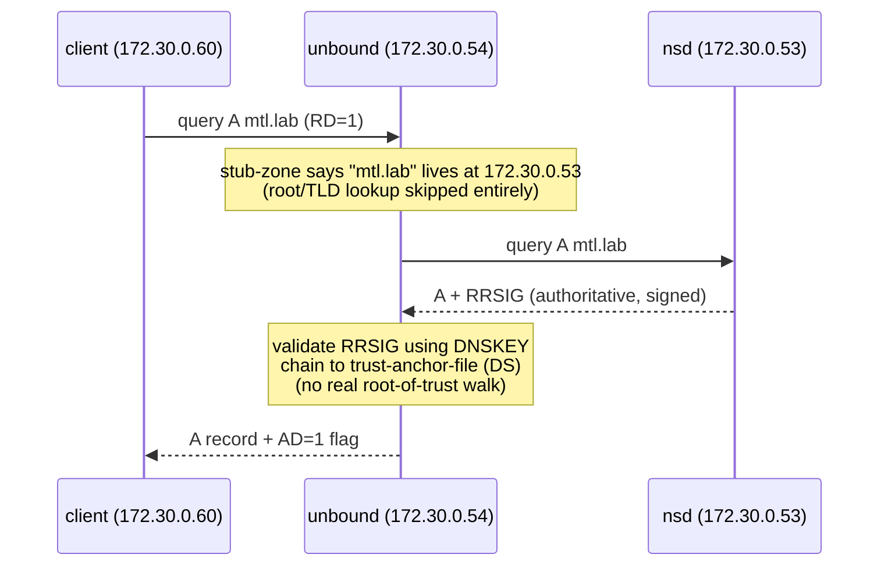
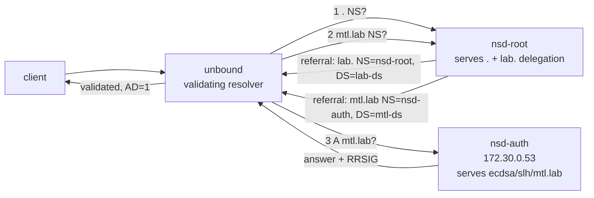

# Lab Infrastructure: Current Setup and Root/TLD Simulation Plan

This document explains **what is actually running today**, **why it was built this way**,
and **what would need to change** to simulate a realistic root → TLD → authoritative
delegation chain instead of the current shortcut.

---

## 1. Current infrastructure (as built)

### 1.1 Containers and network

| Container   | Image               | Address       | Role                                            |
|-------------|----------------------|---------------|--------------------------------------------------|
| `signer`    | `pqc_ldns:latest`     | none (offline)| One-shot: generates + signs zones, writes DS records |
| `nsd`       | `mtl-nsd:latest`      | 172.30.0.53   | Authoritative server for `ecdsa.lab`, `slh.lab`, `mtl.lab` |
| `unbound`   | `mtl-unbound:latest`  | 172.30.0.54   | Validating resolver |
| `client`    | `mtl-unbound:latest`  | 172.30.0.60   | Shell for `dig`/`tcpdump` |
| `capture-*` | reuse `mtl-nsd` image | network_mode of nsd/unbound | Optional tcpdump sidecars |

All containers sit on one Docker bridge network, `lab` (fixed bridge name `pqclab0`,
subnet `172.30.0.0/24`), defined in [compose.yaml](../compose.yaml).



### 1.1.1 Container-level view (images, volumes, ports)

A more detailed, per-container breakdown of exactly what each container runs, mounts,
and exposes — useful when you need to know which host port or bind-mount maps to what,
without digging back into `compose.yaml`.



**Key things this view makes explicit:**
- `signer` has **no network** (`network_mode: none`) — it only ever touches the
  `./zones` bind mount, never the `lab` network. It writes `*.signed` zone files and
  `trust-anchors.txt`, then exits.
- `nsd` and `unbound` both mount `./zones`, but **`nsd` needs read-write** (NSD's own
  zone/db state) while **`unbound` only needs read-only** access to pick up
  `trust-anchors.txt`.
- `unbound`'s behavior is driven entirely by the single bind-mounted
  [config/unbound.conf](../config/unbound.conf) file — editing that file and restarting
  the container is the only way to change resolver behavior.
- `client` has no bind mount to `./zones` at all — it's purely a query/capture shell,
  isolated from the signing pipeline.
- Host ports `5301`/`5302` map directly to `nsd`/`unbound` so you can `dig @localhost -p 5301`
  from outside Docker entirely, bypassing the `client` container if you want.

### 1.2 Why images are built from source (`build-images.sh`)

Verisign's MTL (Merkle Tree Ladder) fork isn't published as ready-made Docker images, so
[build-images.sh](../build-images.sh):

1. Clones 4 Verisign repos into `vendor/` and checks out **pinned commits** (a `PIN`
   associative array) — pinning avoids the lab silently breaking when upstream changes.
2. Applies local `.patch` files from `patches/` on top of each pinned checkout (see §1.4).
3. Builds a shared crypto base image (`pqc-base`, OpenSSL 3.6.0 + liboqs 0.16.0 from
   source) and the `mtl-mode` library layer on top of it.
4. Builds three application images from that base: `pqc_ldns` (signer), `mtl-nsd`
   (authoritative server), `mtl-unbound` (resolver).

**Why liboqs is needed at all:** stock OpenSSL doesn't implement SLH-DSA/SPHINCS+.
ECDSA (alg 13) is native OpenSSL and doesn't touch liboqs — liboqs exists purely to
supply the post-quantum signature algorithm (alg 246 plain, alg 130 MTL-compressed).

### 1.3 Why three parallel zones, not one

[scripts/sign-zones.sh](../scripts/sign-zones.sh) signs the **same generated zone
content** three times with three different algorithms:

| Zone        | Algorithm                              | Purpose                         |
|-------------|------------------------------------------|----------------------------------|
| `ecdsa.lab` | ECDSAP256SHA256 (alg 13)                 | Classical baseline               |
| `slh.lab`   | SLH-DSA-SHA2-128s (alg 246, pure FIPS 205)| Post-quantum, no compression     |
| `mtl.lab`   | SLH-DSA-SHA2-128s-MTL-SHA2-128 (alg 130)  | Post-quantum + MTL compression   |

This is deliberate: the lab's whole point is an apples-to-apples comparison of signing
time, signature size, and UDP/TCP behavior across the three. [scripts/gen-zone.py](../scripts/gen-zone.py)
uses a **fixed random seed (36)**, so all three zones contain byte-identical record data —
only the signature differs.

### 1.4 Why patches exist

The vendored repos are pinned to specific commits and are **not** committed to this repo's
git history (`vendor/` is gitignored) — instead, deltas are kept as `.patch` files that
re-apply automatically on every `build-images.sh` run:

| Patch                                   | Fixes                                                             |
|-------------------------------------------|--------------------------------------------------------------------|
| `MTL-dnf-openssl-fix.patch`               | Build-time conflict between custom-built OpenSSL and `dnf`'s own OpenSSL dependency |
| `mtl-mode-ldns-dnf-openssl-fix.patch`     | Same dnf/OpenSSL conflict, in the ldns image build                |
| `mtl-mode-nsd-dnf-openssl-fix.patch`      | Same dnf/OpenSSL conflict, in the NSD image build                 |
| `mtl-mode-unbound-dnf-openssl-fix.patch`  | Same dnf/OpenSSL conflict, in the Unbound image build              |
| `mtl-mode-nsd-condensed-default.patch`    | Makes NSD default to the condensed/MTL signature format            |
| `mtl-mode-unbound-slh-dsa-pure.patch`     | Adds/fixes Unbound's validation path for plain SLH-DSA (alg 246)   |

Keeping these as patches (rather than hand-editing `vendor/`) means a clean
`build-images.sh` re-run from scratch always reproduces the same working state.

### 1.5 Why there is no real root/TLD today — the stub-zone shortcut

[config/unbound.conf](../config/unbound.conf) does **not** make Unbound walk the DNS
hierarchy. It uses `stub-zone` + a flat `trust-anchor-file`:

```
stub-zone:
    name: "mtl.lab"
    stub-addr: 172.30.0.53
...
trust-anchor-file: "/zones/trust-anchors.txt"
```

This tells Unbound: *"don't look anything up — `mtl.lab` lives at 172.30.0.53, and trust
this DS record directly, no questions asked."* The DS records in `trust-anchors.txt` are
written directly by the signer (`ldns-key2ds` in `sign-zones.sh`), bypassing any parent
zone signing them over.

**Why it was built this way:** this lab's goal is measuring **signing/validation
performance per algorithm**, not demonstrating full delegation. Stub-zones eliminate an
entire layer of referral traffic and let every captured packet be directly about the
zone under test. It trades away realism for a clean, minimal benchmark setup.



---

## 2. Adding a simulated root + TLD

To mimic the real world, we need a genuine delegation chain:
`.` (root) → `lab.` (TLD) → `ecdsa.lab` / `slh.lab` / `mtl.lab` (your existing zones),
with Unbound performing real **iterative resolution** starting from root hints, instead
of stub-zones.



### 2.1 New container: `nsd-root`

- New service in `compose.yaml`, reusing the existing `mtl-nsd:latest` image (no new
  image build needed — just a second NSD instance with different zone data).
- New fixed address, e.g. `172.30.0.52`.
- Serves **two** zones:
  - `.` (root) — contains an `NS` record + glue `A` record delegating `lab.` to itself
    (or to a distinct address if you want a 3-tier split later).
  - `lab.` (TLD) — contains `NS` + `DS` records delegating `ecdsa.lab`, `slh.lab`,
    `mtl.lab` each to the existing `nsd` at 172.30.0.53.

### 2.2 New zone files and signing changes

- Add `root.zone` and `lab.zone` to `scripts/gen-zone.py` (or a new small script —
  these are tiny, hand-writable zone files, not the 100-host-record generated ones).
- Extend `scripts/sign-zones.sh` to sign `lab.zone` (so its `DS`→child-zone records are
  trustworthy) and optionally sign `root.zone` too. A real root is DNSSEC-signed; for a
  lab you can leave the root zone unsigned and just seed Unbound's trust anchor one
  level down at `lab.`, or sign root as well for full realism.
- Each of `ecdsa.lab.zone`, `slh.lab.zone`, `mtl.lab.zone`'s DS record (already computed
  today via `ldns-key2ds`) must be copied into `lab.zone` as a delegation record, rather
  than written straight into Unbound's flat `trust-anchors.txt`. This is the key
  structural change — DS records move from "resolver config" to "parent zone data",
  which is how real DNSSEC chains of trust actually work.

### 2.3 Unbound config changes (`config/unbound.conf`)

Remove the three `stub-zone` blocks and replace with:

```
server:
    root-hints: "/zones/root.hints"
    trust-anchor-file: "/zones/trust-anchors.txt"   # now contains ONLY the root (or lab.) DS
```

- `root.hints` is a standard-format hints file pointing at `nsd-root`'s address
  (172.30.0.52) for `.`.
- `trust-anchor-file` now seeds trust at the top of the chain only (root or `lab.`),
  not at every leaf zone — Unbound builds the rest of the chain itself via the DS/DNSKEY
  records it discovers while following referrals.

### 2.4 Compose + networking changes

- Add the `nsd-root` service to `compose.yaml` with its own static IP in the `lab`
  network (e.g. `172.30.0.52`).
- Add `depends_on: [nsd-root]` to `unbound` (it already depends on `nsd`).
- No changes needed to `nsd` itself — it keeps serving the three `.lab` zones exactly
  as it does today; it simply becomes a "child" delegated to by `nsd-root` instead of
  being addressed directly by stub-zone.

### 2.5 Observable difference after the change

Today's packet capture shows **one** round trip (client→unbound→nsd→unbound→client,
plus possibly a cold-cache DNSKEY fetch). After this change, a cold-cache query should
show **two** extra unbound↔nsd-root round trips before the existing unbound↔nsd
exchange — this is the part worth demonstrating in Wireshark, since it's the part most
people never see in a real resolver (it's normally cached/hidden by the full public
root/TLD infrastructure).

### 2.6 Summary of file changes required

| File                              | Change                                                        |
|------------------------------------|----------------------------------------------------------------|
| `compose.yaml`                     | Add `nsd-root` service + static IP; add `depends_on`          |
| `scripts/gen-zone.py` (or new script) | Generate `root.zone` and `lab.zone` content                 |
| `scripts/sign-zones.sh`            | Sign `lab.zone` (and optionally `root.zone`); write delegation DS records into `lab.zone` instead of (or in addition to) `trust-anchors.txt` |
| `config/unbound.conf`              | Replace `stub-zone` blocks with `root-hints`; shrink `trust-anchor-file` to just the top of the chain |
| New: `zones/root.hints`            | Standard root-hints file pointing at `nsd-root`               |

This is additive — the existing `ecdsa.lab`/`slh.lab`/`mtl.lab` signing and benchmark
flow is untouched; you're only inserting a realistic lookup path in front of it.
